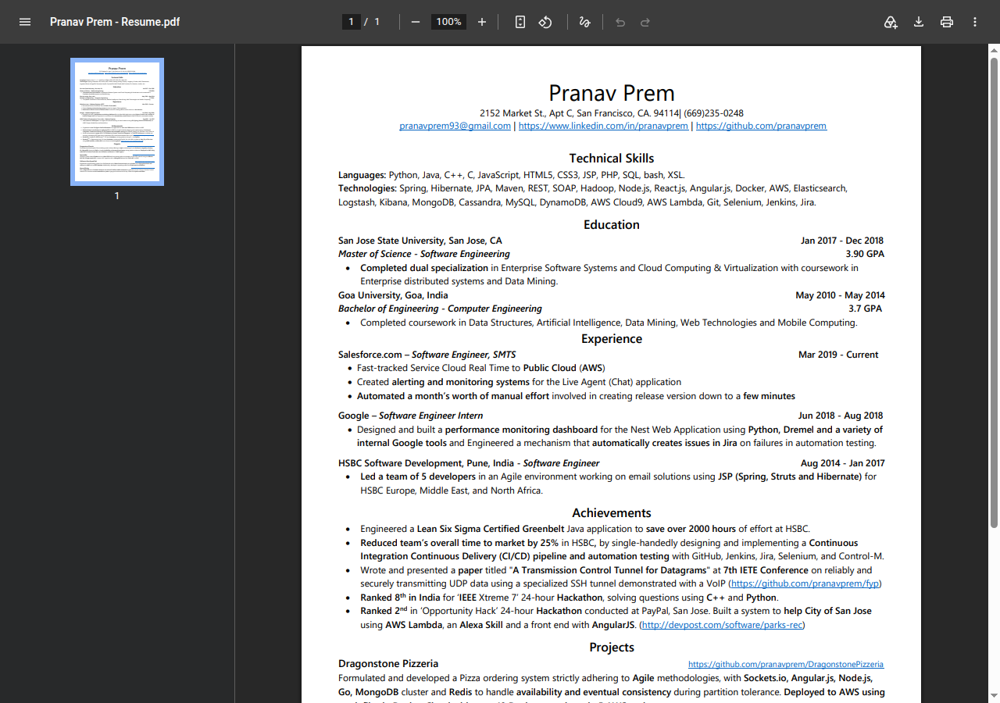

# Pranav Prem | Resume

Live one-page resume: <https://pranavprem.github.io/>.

The page is a full-window frame around `Pranav Prem - Resume.pdf`. It is still the site GitHub Pages publishes from this repository. Pranav's later work lives in [portfolio](https://github.com/pranavprem/portfolio) and is a different site (`pranavprem.com`). This repo is not that portfolio.



## How it is built and deployed

Nothing is compiled. `index.html` and the PDF are the site.

GitHub Pages is a legacy project site on branch `master`, directory `/`. A push to `master` is the deploy. The check workflow does not publish anything.

The PDF filename is part of the public URL. It contains spaces on purpose; the page points at that exact name.

## Run it locally

From the repository root:

```bash
python3 -m http.server 8080
```

Then open <http://127.0.0.1:8080/>.

Use a local server. Opening the HTML file directly can block the PDF frame.

`npm run serve` is the same Python server.

## Stack

- HTML page, one CSS block, no application JavaScript
- The resume PDF
- GitHub Pages, serving the repository root
- Dev-only checks: Node.js 22, Prettier, and html-validate

Those checks never rewrite the page Pages serves.

## Repository structure

| Path                       | What it is                                             |
| -------------------------- | ------------------------------------------------------ |
| `index.html`               | The page served at `/`                                 |
| `Pranav Prem - Resume.pdf` | The resume embedded in that page                       |
| `favicon.ico`              | Present so `/favicon.ico` is not a 404                 |
| `docs/screenshot.png`      | The image in this README                               |
| `scripts/check-site.js`    | Confirms the frame target, the PDF, and the icon exist |
| `.github/workflows/ci.yml` | Runs the checks on pull requests and on `master`       |
| `AGENTS.md`                | Guide for people and agents changing the repo          |
| `CLAUDE.md`                | Points at `AGENTS.md`                                  |

## Checks

```bash
npm ci
npm run validate
```

`npm run validate` checks formatting, HTML, and that every local file the page references is in the tree. `npm run format` applies Prettier.
